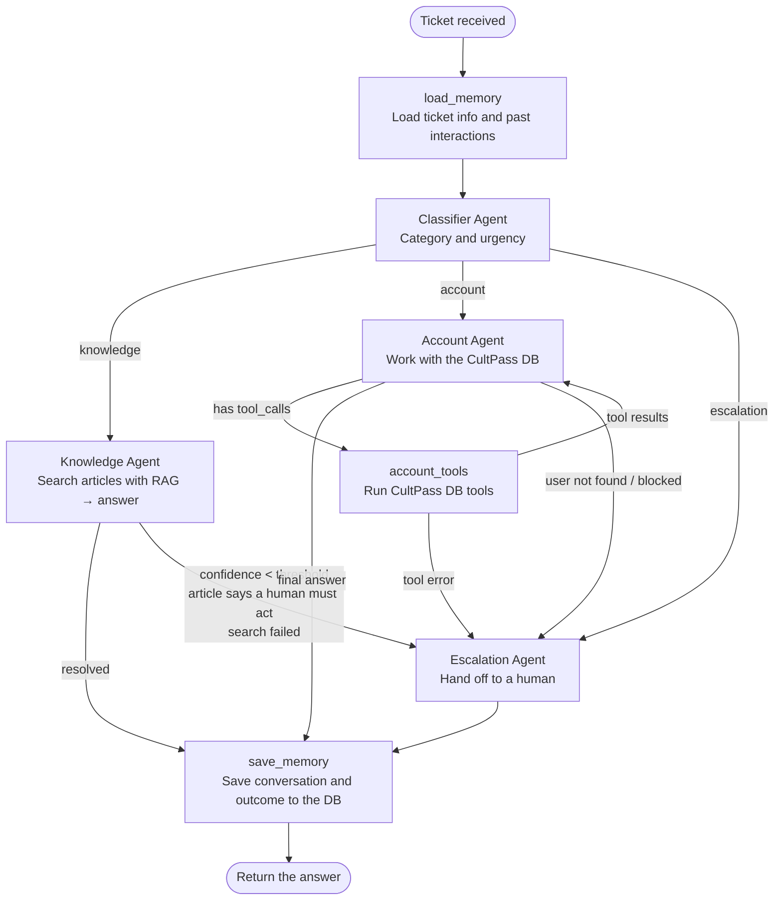

# UDA-Hub: A Multi-Agent System for Customer Support

UDA-Hub is a multi-agent system, built with LangGraph, that handles customer support tickets automatically.
It reads a ticket, classifies it, sends it to the right agent, and answers from knowledge articles and the customer database. When it cannot answer with confidence, or when a person needs to decide, it escalates the ticket to a human agent.

The first customer is **CultPass**, a fictional subscription service for cultural experiences.

日本語版: [README_ja.md](README_ja.md)

## Architecture Diagram



- Boxes are **nodes** (units of work in the LangGraph graph).
- Arrow labels are **conditional edges** (routing decisions). Whether a ticket goes to escalation depends on whether a node has put an `escalation_reason` into the State (the `route_after_*` functions in `workflow.py`).
- There are four agents: `Classifier`, `Knowledge`, `Account`, and `Escalation`. `load_memory`, `save_memory`, and `account_tools` are helper nodes, not agents.

## Built With

- [LangGraph](https://langchain-ai.github.io/langgraph/) - The multi-agent graph, state management, and short-term memory (`MemorySaver`)
- [LangChain](https://python.langchain.com/) - LLM calls, tools, and structured output
- [OpenAI API](https://platform.openai.com/) (through Vocareum) - `gpt-5.4-mini` and `text-embedding-3-small`
- [ChromaDB](https://www.trychroma.com/) - Vector search over knowledge articles
- [SQLAlchemy](https://www.sqlalchemy.org/) / SQLite - The CultPass DB and the UDA-Hub DB
- [pytest](https://docs.pytest.org/) - Tests

## Agents

| Agent                     | Role                                                                                                                                          |
| ------------------------- | --------------------------------------------------------------------------------------------------------------------------------------------- |
| **Classifier** (supervisor) | Decides the category (`knowledge` / `account` / `escalation`) and the urgency from the ticket content and metadata                          |
| **Knowledge**             | Searches knowledge articles with vector search (RAG) and answers only from what the articles say. Escalates when confidence is below the threshold (0.30) |
| **Account**               | Answers with CultPass DB tools (look up the profile, subscription, and reservations, and cancel a reservation)                               |
| **Escalation**            | Writes a message for the customer and a handoff summary for the human agent                                                                   |

For the full design, see [solution/agentic/design/architecture.md](solution/agentic/design/architecture.md) (Japanese version: [architecture_ja.md](solution/agentic/design/architecture_ja.md)).

## Getting Started

### Dependencies

- Python 3.11
- An OpenAI API key from Udacity (Vocareum), set as the environment variable `VOCAREUM_API_KEY`
- Models: `gpt-5.4-mini` (agents) and `text-embedding-3-small` (knowledge search)
- Python packages: [requirements.txt](requirements.txt)

```text
langgraph, langchain, langchain-openai, langchain-chroma, chromadb,
sqlalchemy, python-dotenv, pytest, and others
```

### Installation

1. Create a virtual environment and install the packages (run this in the project root).

   ```bash
   python3.11 -m venv venv
   source venv/bin/activate
   pip install -r requirements.txt
   ```

2. Create a `.env` file with your API key. Put it in `solution/` or in any folder above it (`load_dotenv()` searches up through the parent folders).

   ```text
   VOCAREUM_API_KEY=your-api-key
   ```

3. In `solution/`, run the notebooks in order to create the databases.

   | Notebook                     | What it creates                                                                                                                      |
   | ---------------------------- | ------------------------------------------------------------------------------------------------------------------------------------ |
   | `01_external_db_setup.ipynb` | `data/external/cultpass.db` (CultPass side: users, subscriptions, experiences, reservations)                                         |
   | `02_core_db_setup.ipynb`     | `data/core/udahub.db` (UDA-Hub core: accounts, users, tickets, ticket_metadata, ticket_messages, knowledge, including 14 articles) |

   The ChromaDB store for knowledge search (`data/core/chroma/`) is built automatically from the articles in udahub.db the first time a search runs.

### Running

In `solution/`, run `03_agentic_app.ipynb` from top to bottom. It:

- Shows a diagram of the graph.
- Runs six scenarios with sample tickets (see the table below).
- Shows the State history (per `thread_id`), the conversations saved in the DB, and the logs.
- Offers an interactive mode with `chat_interface()` in the last cell (type `q` to quit).

| Scenario | Ticket                                                                                 | Expected flow                                                         |
| -------- | -------------------------------------------------------------------------------------- | --------------------------------------------------------------------- |
| 1        | How to use the QR code                                                                 | knowledge → resolved                                                  |
| 2        | Subscription inquiry → "How many times a month can I use it?" (follow-up on the same ticket) | account → resolved (short-term memory)                          |
| 3        | Double charge                                                                          | knowledge → escalated (refers to a past ticket; long-term memory)     |
| 4        | Reservation cancellation by a blocked user                                             | account → escalated                                                   |
| 5        | Gift card / asking for a manager in Japanese                                           | knowledge → escalated / escalation → escalated                        |
| 6        | A user who is not registered with CultPass                                             | account → escalated (`User not found`)                                |

Notes:

- Running notebook 03 adds tickets to udahub.db. To reset it, run `02_core_db_setup.ipynb` again.
- Logs are written in JSON Lines format to `solution/logs/workflow.jsonl`. Use `read_logs(ticket_id)` to get the logs for one ticket.

## Testing

Run this in `solution/`:

```bash
../venv/bin/python -m pytest -v
```

- The tests work on copies of the databases, so they never change the real ones.
- Three of the knowledge search tests create real embeddings and call the API. They are skipped automatically when `VOCAREUM_API_KEY` is not set.

### Break Down Tests

There are 49 tests in total.

| File                             | Tests | What they check                                                                                                                                                                                                                                                                                  |
| -------------------------------- | ----- | ------------------------------------------------------------------------------------------------------------------------------------------------------------------------------------------------------------------------------------------------------------------------------------------------ |
| `tests/test_cultpass_tools.py`   | 20    | CultPass DB tools: looking up users, subscriptions, and reservation lists, and cancelling reservations (the 24-hour rule, already cancelled, someone else's reservation, blocked users, events that have already started). When the DB is missing or an argument is missing, the tools return `{"ok": False, "error": ...}` instead of raising an exception |
| `tests/test_knowledge_search.py` | 9     | Knowledge search: errors for empty questions and failed searches, loading articles, and the tool wrapper. Related questions score at or above the confidence threshold, unrelated questions score below it, and articles are sorted by score                                                      |
| `tests/test_memory.py`           | 20    | Long-term memory (udahub.db): creating tickets, saving conversations (without saving twice), updating the status, getting past interactions (newest first, limited count, never mixed with other users), and saving handoff summaries                                                            |

Examples:

```text
tests/test_cultpass_tools.py::test_cancel_other_users_reservation        … cannot cancel someone else's reservation
tests/test_knowledge_search.py::test_unrelated_question_is_not_confident … an unrelated question gets low confidence
tests/test_memory.py::test_past_context_does_not_mix_users               … never mixes in another user's history
```

The end-to-end flow (classify → route → answer / escalate → save) is checked with the scenarios in `03_agentic_app.ipynb`.

## Project Instructions

All deliverables are in `solution/`.

```text
solution/
├── 01_external_db_setup.ipynb   # Creates the CultPass DB
├── 02_core_db_setup.ipynb       # Creates the UDA-Hub DB (14 articles)
├── 03_agentic_app.ipynb         # Runs the scenarios; inspects State, DB, and logs
├── utils.py                     # chat_interface() and other helpers
├── agentic/
│   ├── design/                  # Design documents (architecture.md, architecture_ja.md)
│   ├── agents/                  # classifier, knowledge, account, escalation, llm
│   ├── tools/                   # cultpass_tools, knowledge_search, memory
│   ├── state.py                 # The graph State (SupportState)
│   ├── logging_utils.py         # JSON Lines logging
│   └── workflow.py              # The LangGraph graph (built from scratch)
├── data/
│   ├── external/                # CultPass data (jsonl) and cultpass.db
│   ├── core/                    # udahub.db and chroma/
│   └── models/                  # SQLAlchemy models
├── logs/workflow.jsonl          # Run logs
└── tests/                       # pytest
```

Where each rubric item is covered:

| Rubric item                                           | Where                                                            |
| ----------------------------------------------------- | ---------------------------------------------------------------- |
| Databases and knowledge base (14+ articles)           | Notebooks `01` and `02`, `data/external/cultpass_articles.jsonl` |
| Architecture design document and diagram              | `agentic/design/architecture.md`                                 |
| 4+ specialized agents implemented with LangGraph      | `agentic/agents/`, `agentic/workflow.py`                         |
| Routing based on classification                       | The Classifier and the conditional edges in `workflow.py`        |
| RAG and confidence-based escalation                   | `agentic/tools/knowledge_search.py`, the Knowledge agent         |
| CultPass DB tools (2+, with error handling)           | `agentic/tools/cultpass_tools.py` (4 tools)                      |
| Short-term memory                                     | LangGraph `MemorySaver` with `thread_id` (= `ticket_id`)         |
| Long-term memory                                      | Past tickets in udahub.db (`agentic/tools/memory.py`)            |
| Structured, searchable logs                           | `agentic/logging_utils.py`, `logs/workflow.jsonl`                |
| Test cases                                            | `tests/`                                                         |

### Key Design Decisions

- **Supervisor pattern**: The Classifier acts as the coordinator and routes each ticket to a specialized agent.
- **Confidence**: `1 − cosine distance of the top search result`. The threshold is 0.30, based on measured scores (related questions: 0.312–0.659; unrelated questions: 0.136–0.253).
- **Two-layer tools**: The core of each tool is a function that returns a dict. It never raises an exception and returns either `{"ok": True, "data": ...}` or `{"ok": False, "error": ...}`. An `@tool` wrapper on top exposes it to the LLM.
- **Safety measures**: Before the Account agent's tools run, `user_id` is overwritten with the value from the State, so the agent cannot touch another user's data. The profile tool does not return names or email addresses. A reservation is cancelled only after the customer confirms.

## License

Created as a project for a Udacity course.
