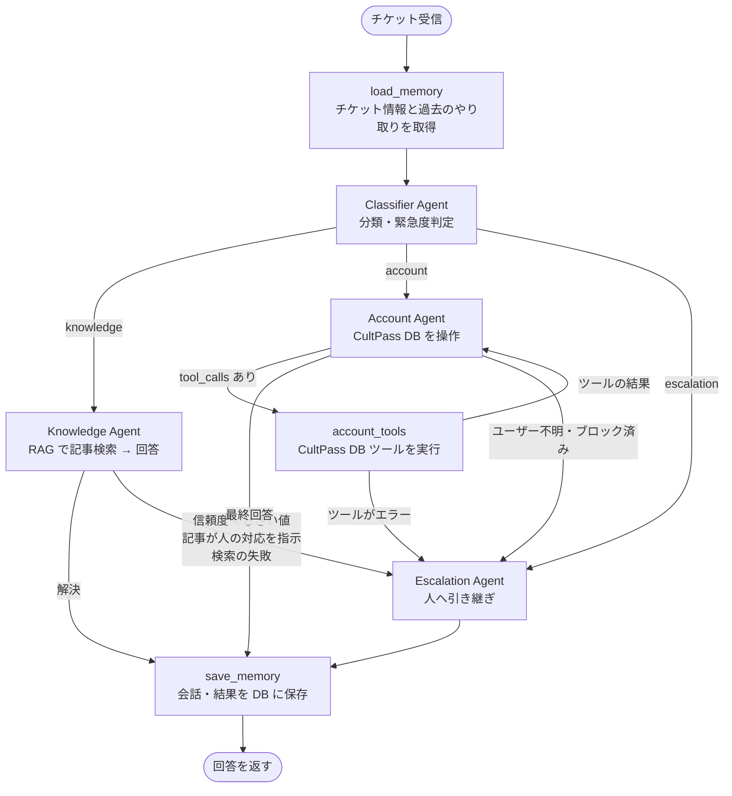

# UDA-Hub：カスタマーサポート用マルチエージェントシステム

UDA-Hub は、カスタマーサポートのチケットを自動で処理するマルチエージェントシステムです。LangGraph で構築しています。
チケットを読み取って分類し、担当のエージェントに振り分け、ナレッジ記事や顧客 DB をもとに回答します。自信を持って答えられないときや、人の判断が必要なときは、人間の担当者にエスカレーションします。

最初の導入顧客は **CultPass**（文化体験のサブスクリプションサービス。架空の会社）です。

## システム構成図



- 四角は **ノード**（LangGraph のグラフ上の処理単位）を表します。
- 矢印のラベルは **条件付きエッジ**（ルーティングの判断）を表します。エスカレーションに進むかどうかは、各ノードが State に `escalation_reason` を入れたかどうかで決めます（`workflow.py` の `route_after_*` 関数）。
- エージェントは `Classifier`、`Knowledge`、`Account`、`Escalation` の 4 つです。`load_memory`、`save_memory`、`account_tools` はエージェントではなく、補助のノードです。

## 使用技術

- [LangGraph](https://langchain-ai.github.io/langgraph/) - マルチエージェントのグラフ、状態管理、短期メモリ（`MemorySaver`）
- [LangChain](https://python.langchain.com/) - LLM の呼び出し、ツール、構造化出力
- [OpenAI API](https://platform.openai.com/)（Vocareum 経由） - `gpt-5.4-mini`、`text-embedding-3-small`
- [ChromaDB](https://www.trychroma.com/) - ナレッジ記事のベクトル検索
- [SQLAlchemy](https://www.sqlalchemy.org/) / SQLite - CultPass DB と UDA-Hub DB
- [pytest](https://docs.pytest.org/) - テスト

## エージェント

| エージェント                       | 役割                                                                                                                  |
| ---------------------------------- | --------------------------------------------------------------------------------------------------------------------- |
| **Classifier**（スーパーバイザー） | チケットの内容とメタデータから、カテゴリ（`knowledge` / `account` / `escalation`）と緊急度を決める                    |
| **Knowledge**                      | ナレッジ記事をベクトル検索（RAG）し、記事の内容だけをもとに回答する。信頼度がしきい値（0.30）未満ならエスカレーション |
| **Account**                        | CultPass DB のツール（プロフィール、サブスクリプション、予約の照会・キャンセル）を使って回答する                      |
| **Escalation**                     | お客さん向けの案内文と、担当者向けの引き継ぎ要約（handoff summary）を作る                                             |

詳しい設計は [solution/agentic/design/architecture_ja.md](solution/agentic/design/architecture_ja.md)（英語版：[architecture.md](solution/agentic/design/architecture.md)）を参照してください。

## はじめに

### 依存関係

- Python 3.11
- Udacity（Vocareum）経由の OpenAI API キー（環境変数 `VOCAREUM_API_KEY`）
- 使うモデル：`gpt-5.4-mini`（エージェント）、`text-embedding-3-small`（ナレッジ検索）
- Python パッケージ：[requirements.txt](requirements.txt)

```text
langgraph, langchain, langchain-openai, langchain-chroma, chromadb,
sqlalchemy, python-dotenv, pytest など
```

### インストール

1. 仮想環境を作り、パッケージを入れます（プロジェクトのルートで実行）。

   ```bash
   python3.11 -m venv venv
   source venv/bin/activate
   pip install -r requirements.txt
   ```

2. `.env` ファイルを作り、API キーを書きます。`solution/` か、その上のフォルダーに置いてください（`load_dotenv()` が親フォルダーをさかのぼって探します）。

   ```text
   VOCAREUM_API_KEY=your-api-key
   ```

3. `solution/` でノートブックを順に実行し、データベースを作ります。

   | ノートブック                 | 作るもの                                                                                                                       |
   | ---------------------------- | ------------------------------------------------------------------------------------------------------------------------------ |
   | `01_external_db_setup.ipynb` | `data/external/cultpass.db`（CultPass 側：users、subscriptions、experiences、reservations）                                    |
   | `02_core_db_setup.ipynb`     | `data/core/udahub.db`（UDA-Hub 本体：accounts、users、tickets、ticket_metadata、ticket_messages、knowledge。記事 14 件を含む） |

   ナレッジ検索用の ChromaDB（`data/core/chroma/`）は、初めて検索したときに udahub.db の記事から自動で作られます。

### 実行

`solution/` で `03_agentic_app.ipynb` を上から実行します。

- グラフの図を表示します。
- サンプルチケットで 6 つのシナリオを実演します（下の表）。
- State の履歴（`thread_id` ごと）、DB に保存された会話、ログを確認します。
- 最後のセルで `chat_interface()` による対話モードを使えます（`q` で終了）。

| シナリオ | 内容                                                                   | 期待する流れ                                              |
| -------- | ---------------------------------------------------------------------- | --------------------------------------------------------- |
| 1        | QR コードの使い方                                                      | knowledge → resolved                                      |
| 2        | サブスクリプションの照会 →「月に何回使える？」（同じチケットで続ける） | account → resolved（短期メモリ）                          |
| 3        | 二重請求                                                               | knowledge → escalated（過去のチケットを参照。長期メモリ） |
| 4        | ブロック済みユーザーの予約キャンセル                                   | account → escalated                                       |
| 5        | ギフトカード／日本語で責任者を希望                                     | knowledge → escalated／escalation → escalated             |
| 6        | CultPass に登録のないユーザー                                          | account → escalated（`User not found`）                   |

注意：

- 03 を実行すると udahub.db にチケットが増えます。元に戻すには `02_core_db_setup.ipynb` を再実行してください。
- ログは JSON Lines 形式で `solution/logs/workflow.jsonl` に書かれます。`read_logs(ticket_id)` でチケットごとに取り出せます。

## テスト

`solution/` で次を実行します。

```bash
../venv/bin/python -m pytest -v
```

- テストは DB のコピーを使うので、本物の DB は書き換えません。
- ナレッジ検索のテストのうち、実際に埋め込みを作るもの（3 件）は API を使います。`VOCAREUM_API_KEY` がないときは自動でスキップされます。

### テストの内訳

全 49 件です。

| ファイル                         | 件数 | 何を確かめるか                                                                                                                                                                                                                                                      |
| -------------------------------- | ---- | ------------------------------------------------------------------------------------------------------------------------------------------------------------------------------------------------------------------------------------------------------------------- |
| `tests/test_cultpass_tools.py`   | 20   | CultPass DB ツール。ユーザーの照会、サブスクリプション、予約の一覧、予約のキャンセル（24 時間以内の判定、キャンセル済み、他人の予約、ブロック済みユーザー、開始済みのイベント）。DB がない・引数がないときに、例外ではなく `{"ok": False, "error": ...}` を返すこと |
| `tests/test_knowledge_search.py` | 9    | ナレッジ検索。空の質問や検索の失敗でエラーを返すこと、記事の読み込み、ツールのラッパー。関係のある質問は信頼度がしきい値以上、関係のない質問は未満になること、記事がスコア順に並ぶこと                                                                              |
| `tests/test_memory.py`           | 20   | 長期メモリ（udahub.db）。チケットの作成、会話の保存（二重保存しない）、ステータスの更新、過去のやり取りの取得（新しい順・件数の上限・他のユーザーと混ざらない）、引き継ぎ要約の保存                                                                                 |

例：

```text
tests/test_cultpass_tools.py::test_cancel_other_users_reservation   … 他人の予約はキャンセルできない
tests/test_knowledge_search.py::test_unrelated_question_is_not_confident … 関係のない質問は信頼度が低い
tests/test_memory.py::test_past_context_does_not_mix_users           … 他のユーザーの履歴を混ぜない
```

エンドツーエンドの動作（分類 → ルーティング → 回答 / エスカレーション → 保存）は、`03_agentic_app.ipynb` のシナリオで確かめます。

## プロジェクトの成果物

すべて `solution/` にあります。

```text
solution/
├── 01_external_db_setup.ipynb   # CultPass DB の作成
├── 02_core_db_setup.ipynb       # UDA-Hub DB の作成（記事 14 件）
├── 03_agentic_app.ipynb         # シナリオの実演、State・DB・ログの確認
├── utils.py                     # chat_interface() など
├── agentic/
│   ├── design/                  # 設計書（architecture.md、architecture_ja.md）
│   ├── agents/                  # classifier、knowledge、account、escalation、llm
│   ├── tools/                   # cultpass_tools、knowledge_search、memory
│   ├── state.py                 # グラフの State（SupportState）
│   ├── logging_utils.py         # JSON Lines のログ
│   └── workflow.py              # LangGraph のグラフ（ゼロから構築）
├── data/
│   ├── external/                # CultPass のデータ（jsonl）と cultpass.db
│   ├── core/                    # udahub.db、chroma/
│   └── models/                  # SQLAlchemy のモデル
├── logs/workflow.jsonl          # 実行ログ
└── tests/                       # pytest
```

ルーブリックとの対応：

| ルーブリック                                   | 対応する場所                                                     |
| ---------------------------------------------- | ---------------------------------------------------------------- |
| DB とナレッジベース（記事 14 件以上）          | `01`・`02` ノートブック、`data/external/cultpass_articles.jsonl` |
| アーキテクチャの設計書と図                     | `agentic/design/architecture.md`                                 |
| 4 つ以上の専門エージェントを LangGraph で実装  | `agentic/agents/`、`agentic/workflow.py`                         |
| 分類にもとづくルーティング                     | Classifier と `workflow.py` の条件付きエッジ                     |
| RAG と信頼度によるエスカレーション             | `agentic/tools/knowledge_search.py`、Knowledge エージェント      |
| CultPass DB ツール（2 つ以上、エラー処理つき） | `agentic/tools/cultpass_tools.py`（4 つ）                        |
| 短期メモリ                                     | LangGraph の `MemorySaver` と `thread_id`（= `ticket_id`）       |
| 長期メモリ                                     | udahub.db の過去のチケット（`agentic/tools/memory.py`）          |
| 構造化され検索できるログ                       | `agentic/logging_utils.py`、`logs/workflow.jsonl`                |
| テストケース                                   | `tests/`                                                         |

### 主な設計の判断

- **スーパーバイザー型**：Classifier が司令塔になり、専門エージェントに振り分けます。
- **信頼度**：`1 − 検索1位の cosine 距離`。実測（関係あり 0.312〜0.659、関係なし 0.136〜0.253）から、しきい値を 0.30 にしました。
- **ツールの 2 層構造**：本体は dict を返す関数で、例外を投げずに `{"ok": True, "data": ...}` か `{"ok": False, "error": ...}` を返します。LLM 用には `@tool` のラッパーをかぶせています。
- **安全のための工夫**：Account エージェントのツールは、`user_id` を State の値で上書きしてから実行します（他人のデータに触れさせないため）。プロフィールのツールは名前やメールアドレスを返しません。予約のキャンセルは、お客さんに確認してから行います。

## ライセンス

Udacityのコースの課題として作成したものです。
