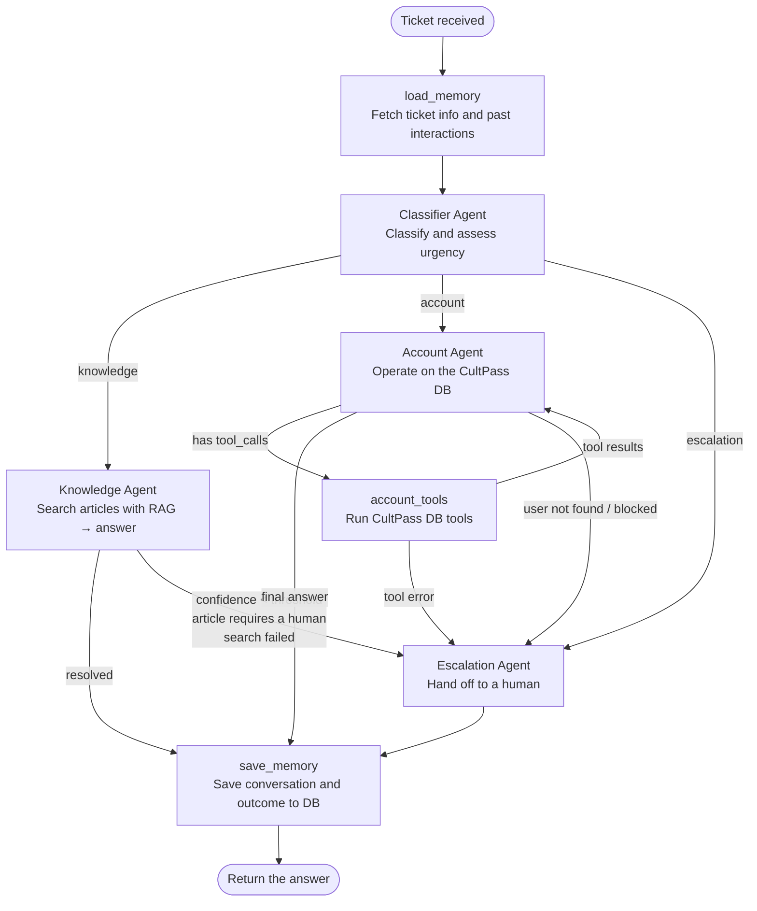
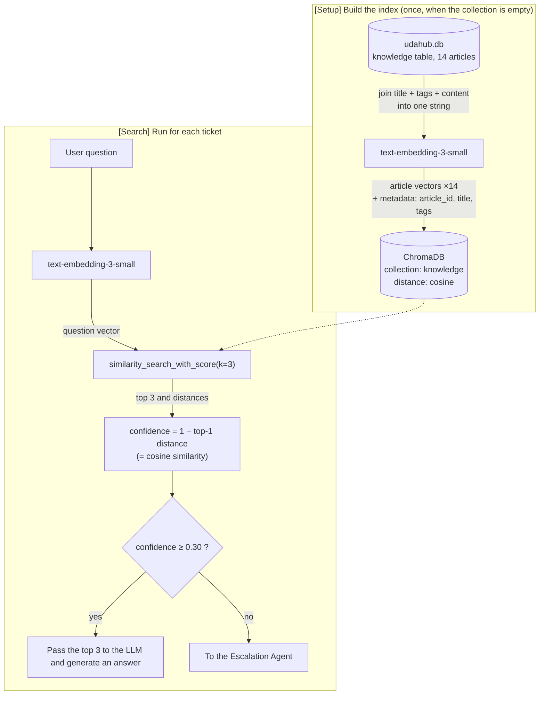
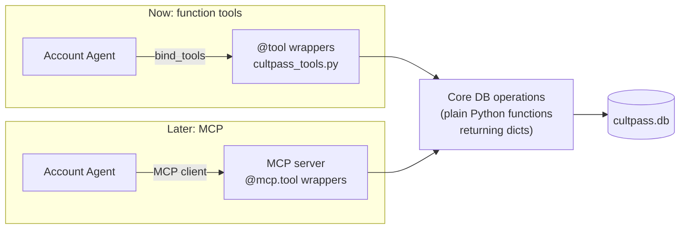

# UDA-Hub Architecture Design

## 1. Overview

UDA-Hub is a multi-agent system that processes customer support tickets automatically.
The first customer is **CultPass** (a subscription service for cultural experiences).

- Reads and classifies each ticket, then routes it to the right agent
- Answers using knowledge articles or data from the CultPass DB
- Escalates to a human agent when it cannot answer confidently or when human judgment is needed

| Item | Choice |
|---|---|
| Orchestration | LangGraph `StateGraph` (the graph is built from scratch; no prebuilt workflows such as `create_react_agent`) |
| LLM | OpenAI `gpt-5.4-mini` (via Udacity's Vocareum; `get_llm()` in `agentic/agents/llm.py` is shared by all four agents) |
| Embedding model | OpenAI `text-embedding-3-small` (for knowledge search) |
| Vector DB | ChromaDB (via LangChain's `langchain_chroma.Chroma`; stores and searches knowledge article embeddings) |
| Architecture pattern | **Supervisor** (the Classifier acts as the supervisor and routes to specialist agents) |

---

## 2. Overall Diagram



- Boxes are **nodes** (units of processing in the LangGraph graph).
- Arrow labels are **conditional edges** (routing decisions). Whether to go to escalation is decided by whether a node has set `escalation_reason` in the State (the `route_after_*` functions in `workflow.py`).
- The four agents are `Classifier`, `Knowledge`, `Account`, and `Escalation`. `load_memory`, `save_memory`, and `account_tools` are not agents; they are helper nodes.
- Each agent is a function in `agentic/agents/` that "takes the State and returns only the fields it updates". `workflow.py` places them as nodes and connects them with conditional edges.

---

## 3. Agent Roles and Responsibilities

### 3.1 Classifier Agent (Supervisor)

| Item | Details |
|---|---|
| Responsibility | Decide the destination and urgency from the ticket content and metadata |
| Input | Latest user message, recent conversation (user and AI message text, up to 6), ticket metadata (`channel`, `main_issue_type`, `tags`, `created_at`), summary of past interactions (`past_context`) |
| Output | `category` (`knowledge` / `account` / `escalation`), `urgency` (`low` / `medium` / `high`), `reason` (the rationale; stored in the State as `classification_reason`) |
| Method | LLM structured output (Pydantic model `Classification`) |

The recent conversation is passed so that short replies such as "Yes, please cancel it" are routed to the same destination as the preceding question.

Classification criteria:

| category | Tickets that belong here | Examples |
|---|---|---|
| `knowledge` | General or how-to questions that do not need user-specific data. Billing, payment, and refund questions also go here (the account tools have no billing data) | "The QR code won't scan", "What does the subscription include?", "I was charged twice this month" |
| `account` | Requires viewing or changing the user's own data. Questions about the user's own plan (plan name, experiences per month) also go here (quotas differ per user, and the correct value exists only in the account data) | "I want to check my reservations", "Cancel my booking for next week", "How many experiences per month does my plan include?" |
| `escalation` | Needs human judgment: clear complaints, legal matters, requests to talk to a human | "I want to speak to a manager", "I'll talk to my lawyer" |

Urgency criteria:

| urgency | Tickets that belong here |
|---|---|
| `high` | The user is angry, mentions legal matters, or the event is today or tomorrow |
| `medium` | The service is unusable, or an account operation is needed |
| `low` | General questions that are not urgent |

### 3.2 Knowledge Agent

| Item | Details |
|---|---|
| Responsibility | Search knowledge articles and answer **based only on the article content** |
| Input | Latest user message, `past_context` |
| Output | Answer text (`AIMessage`), `retrieved_articles` (titles and scores of the retrieved articles), `confidence` |
| Method | RAG (Section 5). ① Call `search_knowledge` directly in code (not as an LLM tool call). ② If confidence is below the threshold, escalate without calling the LLM. ③ Otherwise, pass the top 3 articles to the LLM and have it answer with structured output (`KnowledgeAnswer`). The LLM is instructed not to answer anything that is not in the articles |
| Escalation conditions | The search failed. `confidence` is below the threshold. The LLM returned `needs_escalation = True` (the article itself requires escalation and the user's situation meets that condition, or the articles contain no answer) |

- If an article says "try these steps first, and contact a human if they don't work" (e.g., the QR code won't scan), the agent gives the steps and marks the ticket `resolved`. The user can contact support again if it doesn't work.
- If the user already meets the article's condition (e.g., charged twice in the same month), the agent returns the article's guidance and then escalates.

### 3.3 Account Agent

| Item | Details |
|---|---|
| Responsibility | Query and operate on the CultPass DB through tools to handle user-specific requests |
| Input | The full conversation (`messages`), the CultPass `user_id` of the ticket's user |
| Output | An answer based on the tool results |
| Method | ① Call `get_user_profile(user_id)` directly in code to check that the user exists and is not blocked (this is not left to the LLM). ② Give the tools to the LLM (`bind_tools`) and call them in an `account ⇄ account_tools` loop, built explicitly in the graph. ③ `account_tools` overwrites the `user_id` given by the LLM with the value from the State before running the tool (so it cannot operate on another user's data) |
| Escalation conditions | User not found, or the account is blocked (`is_blocked`) — checked in the `account` node. A tool returned an error (`ok: False`) — checked in the `account_tools` node |

- Three tools are given to the LLM: `get_subscription`, `get_reservations`, and `cancel_reservation`. `get_user_profile` is not given because the code calls it in ①.
- When it is unclear which reservation to cancel, the agent is instructed to ask the user instead of cancelling.

### 3.4 Escalation Agent

| Item | Details |
|---|---|
| Responsibility | Hand off to a human agent, leaving a summary so they can act quickly |
| Input | The full conversation, the escalation reason (`escalation_reason`; `classification_reason` when coming directly from the Classifier), urgency, `past_context`, any guidance already given earlier in this turn |
| Output | A message for the user (in the user's language: "A support agent will follow up"), a summary for the human agent (`handoff_summary`, in English) |
| Method | LLM structured output (`EscalationOutput`). The model answers `customer_language` first, so the reply language is decided up front |
| Side effects | None. DB writes (setting `status` to `escalated`, saving the summary, recording urgency as a tag) are done by `save_memory` (Section 7) |

- The user-facing message does not include internal information such as confidence, tool names, error details, or "blocked".
- If the Knowledge Agent has already given guidance before arriving here (e.g., duplicate charges), the code prepends that guidance to the handoff message, because `chat_interface` only displays the last message.

---

## 4. State and Information Flow

All nodes read and write the following shared State (`agentic/state.py`).
It inherits from LangGraph's `MessagesState`, so the `messages` field that holds the conversation history (short-term memory) is already defined there. New messages are appended to the existing list.

```python
from langgraph.graph import MessagesState

class SupportState(MessagesState):
    # messages: Annotated[list[AnyMessage], add_messages]  ← inherited from MessagesState (conversation = short-term memory)
    ticket_id: str                    # = thread_id
    user_id: str                      # CultPass user ID
    ticket_metadata: dict             # channel, main_issue_type, tags, etc.
    past_context: str                 # summary of past interactions (long-term memory)
    category: str                     # Classifier result (knowledge / account / escalation)
    urgency: str                      # low / medium / high
    classification_reason: str        # Classifier's rationale
    retrieved_articles: list[dict]    # retrieved articles and scores
    confidence: float                 # Knowledge confidence
    escalation_reason: str | None     # reason for escalation
    handoff_summary: str              # handoff summary for the human agent (written by Escalation)
    resolution: str                   # resolved / escalated
```

- Only `messages` and `thread_id` (= `ticket_id`) are passed to the graph. `load_memory` looks up udahub.db by `ticket_id` and puts `user_id` and `ticket_metadata` into the State.
- `MemorySaver` keeps the entire State, so `load_memory` resets the per-turn results (`category` through `resolution`) at the start of each turn. Without the reset, the previous turn's `escalation_reason` would remain and send the ticket to the wrong destination.

As a concrete example, here is how the ticket "I want to cancel my reservation for next week" is processed, step by step:

```
① load_memory      Get user_id from ticket_id. past_context = "- 2026-11-10 [resolved] ...: "The QR code won't scan..." → ..."
② classifier       category = "account", urgency = "medium"
③ account          Check get_user_profile(user_id) in code → OK. The LLM calls get_reservations(user_id)
④ account_tools    → {"ok": true, "data": [{"reservation_id": "r1", ...}]}
⑤ account          The LLM calls cancel_reservation(user_id, "r1")
⑥ account_tools    → {"ok": true, "data": {"status": "cancelled", "within_24h": false, ...}}
⑦ account          Answer: "Your reservation has been cancelled. Your credit will be returned."  resolution = "resolved"
⑧ save_memory      Save the conversation to ticket_messages; set status = "resolved", main_issue_type = "account", tags = "urgency:medium"
```

---

## 5. Knowledge Search (RAG) and Confidence Score

### 5.1 How It Works



- **ChromaDB** is used through LangChain's `Chroma` (`langchain_chroma`) and persisted as the collection `knowledge` in `solution/data/core/chroma/` (`agentic/tools/knowledge_search.py`).
  - The collection is created with the `cosine` distance (`collection_metadata={"hnsw:space": "cosine"}`).
  - If the collection is empty at startup, articles are loaded from the knowledge table in udahub.db and added. When articles are updated, rebuild the collection with `get_vector_store(rebuild=True)`.
  - Each document's `id` is the `article_id`, and its `metadata` holds `article_id`, `title`, and `tags`.
- ChromaDB returns a **distance** (cosine distance = 1 − cosine similarity), so **confidence = 1 − top-1 distance** (0 to 1). Because it is computed rather than self-reported by the LLM, the same input always gives the same value, which makes it easy to test.
- The threshold is **`0.30`** (`CONFIDENCE_THRESHOLD`). It was provisionally set to `0.45` at first, then lowered after looking at actual scores (Section 5.2).
  - With `0.45`, "Can I get my money back?" (0.312) was escalated even though it had found the correct article (Refund Policy).
  - Relevant questions scored 0.312–0.659 and irrelevant ones 0.136–0.253, so `0.30` was chosen between them.
  - The margin is narrow (0.253 vs. 0.312). Short, vague questions may get escalated, but this is acceptable because handing off to a human is safer than answering incorrectly.
- Even above the threshold, the ticket is escalated when the LLM judges that "the articles contain no answer" or "the article requires a human" (Section 3.2).

### 5.2 Measured Scores (2026-11-14, `text-embedding-3-small`)

| Question | Top-1 article | Score | Result |
|---|---|---|---|
| Do unused experiences carry over to next month? | Unused Monthly Experiences (Rollover) | 0.659 | Answer |
| The QR code won't scan at the museum entrance | QR Code Not Working at the Venue | 0.643 | Answer |
| I was charged twice this month | Unexpected or Duplicate Charges | 0.589 | Answer |
| How do I cancel my booking for tomorrow? | How to Cancel or Change a Reservation | 0.534 | Answer |
| The app keeps crashing on my phone | App Crashes or Won't Load | 0.530 | Answer |
| QRコードが読み取れません (Japanese: "The QR code can't be read") | QR Code Not Working at the Venue | 0.528 | Answer |
| How do I change my credit card? | How to Update Payment Method | 0.518 | Answer |
| I forgot my password and can't log in | How to Handle Login Issues? | 0.459 | Answer |
| Can I get my money back? | Refund Policy | 0.312 | Answer |
| Can I bring my dog to the concert? | How to Reserve a Spot for an Event | 0.253 | Escalation |
| Do you sell gift cards? | Unused Monthly Experiences (Rollover) | 0.220 | Escalation |
| I want to talk to your manager right now | How to Update Profile or Email Address | 0.201 | Escalation |
| What's the weather like in Bahia next week? | QR Code Not Working at the Venue | 0.136 | Escalation |

For all 9 relevant questions, the correct article came first (including the Japanese question).

---

## 6. Tools (Abstraction over the CultPass DB)

Implemented as LangChain `@tool` functions in `agentic/tools/cultpass_tools.py`.

| Tool | Input | Output (`data`) | Main validations |
|---|---|---|---|
| `get_user_profile` | `user_id` | `user_id`, `is_blocked` | The user exists |
| `get_subscription` | `user_id` | `status`, `tier`, `monthly_quota`, start and end dates | The user exists, a subscription exists |
| `get_reservations` | `user_id` | List of reservations (`reservation_id`, experience title, location, date/time, whether premium, status). Empty list if none | The user exists |
| `cancel_reservation` | `user_id`, `reservation_id` | Experience title, new status, `within_24h` | The user exists, is not blocked, the reservation exists, belongs to the user, is not already cancelled, and the event has not started |

- Following the rules in the knowledge article "How to Cancel or Change a Reservation", `cancel_reservation` allows cancellation even within 24 hours of the start. In that case it returns `within_24h = True`, and the agent tells the user that the credit will be consumed. Cancelling returns one slot to the experience (`slots_available`).
- `get_user_profile` is called directly in code by the Account Agent (Section 3.3). The other three are given to the LLM.

**Common return shape** (structured response):

```python
{"ok": True,  "data": {...}}                       # success
{"ok": False, "error": "Reservation not found"}    # failure (returned, not raised)
```

- The same shape is used by the knowledge search (`knowledge_search.py`) and long-term memory (`memory.py`) functions.
- The connection to cultpass.db is kept in one place, `cultpass_tools.py`. The path is resolved as an absolute path based on `__file__`, so it works no matter where the notebook is run from. If the DB file does not exist, an error is returned instead of creating an empty DB.
- Agents never write SQL directly. They touch the DB only through tools.

### 6.1 Structure Designed for a Future Move to MCP

The instructions recommend using an MCP server for tools. For ease of understanding, the tools are first built as regular function tools. However, so that they can later be replaced with an MCP server, they are split into the following two layers.



- **Core DB operations**: plain Python functions that take arguments and return a `{"ok", "data"/"error"}` dict. They depend on neither LangChain nor MCP.
- **Wrappers**: a thin layer that only calls the core functions. For now they are wrapped with LangChain's `@tool` (e.g., `get_user_profile_tool`; the name visible to the LLM is the same as the core function). To move to MCP, wrap the same core functions again with an MCP server (e.g., `FastMCP`'s `@mcp.tool`).
- This way, the DB logic and its tests can be reused as-is after moving to MCP.
- `knowledge_search.py` also has a wrapper of the same form (`search_knowledge_tool`). However, the Knowledge Agent calls the core `search_knowledge` directly so that the search always runs.

---

## 7. Memory

| Type | Scope | Storage | Contents | Usage |
|---|---|---|---|---|
| Short-term memory | `thread_id` (= `ticket_id`) | LangGraph `MemorySaver` | Conversation within the same ticket, tool calls and their results, State | Context when continuing the conversation on the same ticket |
| Long-term memory | User (`user_id`) | udahub.db (`ticket_messages`, `ticket_metadata`) | Conversations from past tickets, resolved/escalated outcomes, handoff summaries | `load_memory` retrieves the same user's past tickets and passes them as `past_context` to the Classifier, Knowledge, and Escalation agents |

Long-term memory is read and written by the functions in `agentic/tools/memory.py`. They are called by graph nodes (`load_memory` / `save_memory`), not by the LLM as tools, so no `@tool` wrappers are created.

**Creating a ticket**

- A new inquiry starts with `new_ticket(user_id)` (`workflow.py`). It creates a ticket and its `ticket_metadata` (`status = open`) in udahub.db and returns the `ticket_id`. The graph is then invoked with this `ticket_id` as the `thread_id`.
- If the user does not yet exist in udahub.db, the user is also created (without adding personal information such as names).

**Loading (`load_memory`)**

- Looks up the ticket from `thread_id` and puts the CultPass `user_id` and `ticket_metadata` into the State.
- Retrieves up to 3 of the same user's past tickets (excluding the current one), newest first, and summarizes each as a short line with the date, outcome, category, the first user message, and the last AI message (up to 150 characters each) into `past_context`. For a first-time user it is "No past tickets from this customer."
- The graph does not stop even if a DB function returns an error (if `user_id` is empty, the Account Agent escalates).

**Saving (`save_memory`)** — this is the only node that writes to udahub.db (agents do not write).

- Saves the user messages and the AI messages with text content to `ticket_messages`. Tool calls and results are not saved, since they can be checked in short-term memory. Duplicates are skipped by `message.id`, so messages are not saved twice when the conversation continues on the same ticket.
- When escalated, `handoff_summary` is saved to `ticket_messages` with `role = system` (`[Handoff] ...`). Because `past_context` uses only user and AI messages, the summary does not leak into it.
- Overwrites `status` in `ticket_metadata` with the turn's outcome (`resolved` / `escalated`, or `open` if there is no outcome). However, once a ticket becomes `escalated`, it stays `escalated` (so that a ticket waiting for a human is not hidden by a `resolved` in a later turn).
- Records the Classifier's `category` in `main_issue_type`, and `urgency:<urgency>` in `tags`.

**Example**: When a user whose previous ticket "The QR code won't scan" was resolved comes back, that ticket is included in `past_context`, so the agent can respond with context, e.g., "You also contacted us about a QR code issue last time."

Given a `thread_id`, `graph.get_state(config)` and `graph.get_state_history(config)` show the ticket's messages and tool usage.

---

## 8. Input Types and Expected Outputs

| Input type | Path | Expected output | 03 notebook |
|---|---|---|---|
| General question (article exists) | Classifier → Knowledge | Answer based on the article. `resolved` | Scenario 1 |
| General question (no article) | Classifier → Knowledge → Escalation | Handoff message. `escalated` | Scenario 5 (gift cards) |
| Article requires escalation (e.g., duplicate charges) | Classifier → Knowledge → Escalation | Article guidance plus handoff. `escalated` | Scenario 3 |
| User-specific lookup or operation | Classifier → Account ⇄ Tools | Answer based on tool results. `resolved` | Scenario 2 |
| User not found / blocked | Classifier → Account → Escalation | Handoff message. `escalated` | Scenario 4 (blocked), Scenario 6 (not in CultPass) |
| Tool error | Classifier → Account ⇄ Tools → Escalation | Handoff message. `escalated` | — |
| Explicit request for a human / complaint | Classifier → Escalation | Handoff message. Urgency recorded, `escalated` | Scenario 5 (wants to talk to a manager) |

---

## 9. Logging

- Uses Python's `logging` to write one JSON object per line (JSON Lines) to `solution/logs/workflow.jsonl` (`log_event` in `agentic/logging_utils.py`).
- Logs are written only in `workflow.py`. Agent code contains no logging; instead, each node is wrapped in a small function (e.g., `classifier_step`) that "calls the agent and writes one log line".
- The following events are recorded:

| node | event | Main fields |
|---|---|---|
| `load_memory` | `memory_loaded` | `user_id`, `past_tickets` (number of past tickets), `error` |
| `classifier` | `classified` | `category`, `urgency`, `reason` |
| `knowledge` | `retrieved` | `top_article`, `confidence`, `escalation_reason` |
| `account` | `account_step` | `tool_calls` (names of tools the LLM called), `escalation_reason` |
| `account_tools` | `tool_called` | `tool`, `ok`, `error` (one line per tool) |
| `escalation` | `escalated` | `reason`, `urgency` |
| `save_memory` | `saved` | `status`, `resolution`, `errors` (errors from DB functions) |

```json
{"ts": "2026-11-14T10:00:00", "ticket_id": "t-001", "node": "classifier", "event": "classified", "category": "knowledge", "urgency": "low", "reason": "..."}
{"ts": "2026-11-14T10:00:01", "ticket_id": "t-001", "node": "knowledge", "event": "retrieved", "top_article": "QR Code Not Working at the Venue", "confidence": 0.643, "escalation_reason": null}
```

Logs can be searched and filtered by `ticket_id` or `event`. In the notebook, `read_logs(ticket_id)` shows the flow of a single ticket.

---

## 10. Testing Strategy

| Test | What it checks | Location |
|---|---|---|
| Tool unit tests | Normal cases, non-existent user, blocked user, cancelling another user's reservation, already-cancelled reservation, event already started, cancellation within 24 hours, missing arguments, missing DB file, `@tool` wrappers return the same result as the core functions | `tests/test_cultpass_tools.py` |
| Knowledge search | Relevant questions score at or above the threshold and irrelevant ones below it. Results are sorted by score. Empty queries and search failures return errors | `tests/test_knowledge_search.py` |
| Long-term memory | Creating tickets, saving messages (no duplicates), updating status, retrieving past tickets (newest first, count limit, no mixing of users), handoff summaries do not leak into `past_context` | `tests/test_memory.py` |
| Routing / end-to-end | Each sample ticket is routed to the expected agent, and both "resolved" and "escalated" scenarios work (table in Section 8) | Scenarios 1–6 in `03_agentic_app.ipynb` |
| Short-term memory | The conversation continues on the same `thread_id` (the second question in Scenario 2). Tool calls can also be checked with `get_state_history` | `03_agentic_app.ipynb` |

- `tests/` is run with pytest (`pytest` from `solution/`). Some knowledge search tests call the embedding API.
- Routing and end-to-end behavior depend on LLM output, so they are not automated tests; instead, the results (`category`, `resolution`, logs) are checked in the notebook.

---

## 11. File Structure

```text
solution/agentic/
├── design/
│   ├── architecture.md        # this design document (English)
│   └── architecture_ja.md     # design document (Japanese)
├── state.py                   # shared State (SupportState)
├── agents/
│   ├── llm.py                 # LLM shared by the four agents (get_llm)
│   ├── classifier.py
│   ├── knowledge.py
│   ├── account.py             # account node and account_tools node
│   └── escalation.py
├── tools/
│   ├── cultpass_tools.py      # CultPass DB tools (core + @tool wrappers)
│   ├── knowledge_search.py    # RAG search (ChromaDB)
│   └── memory.py              # long-term memory read/write (udahub.db)
├── logging_utils.py           # structured logging
└── workflow.py                # StateGraph assembly, orchestrator, new_ticket

solution/tests/                # pytest (tools, knowledge search, long-term memory)

solution/data/
├── external/cultpass.db       # CultPass DB (created in notebook 01)
└── core/
    ├── udahub.db              # UDA-Hub DB (created in notebook 02)
    └── chroma/                # ChromaDB persistence directory (auto-generated)

solution/logs/workflow.jsonl   # logs (auto-generated)
```

`State` lives in `state.py` rather than `workflow.py` because both the agents and `workflow.py` import it (putting it in `workflow.py` would cause a circular import).

To move to MCP, add `tools/mcp_server.py` and expose the core functions in `cultpass_tools.py` as MCP tools.
