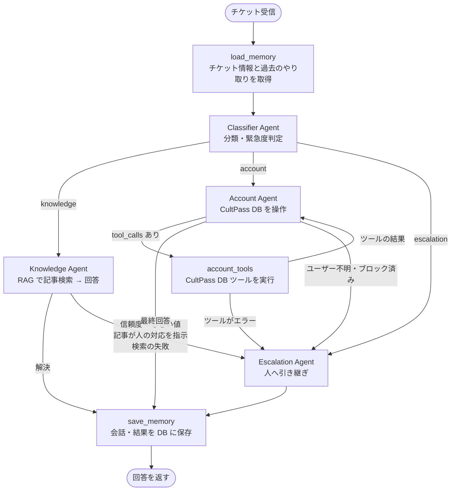
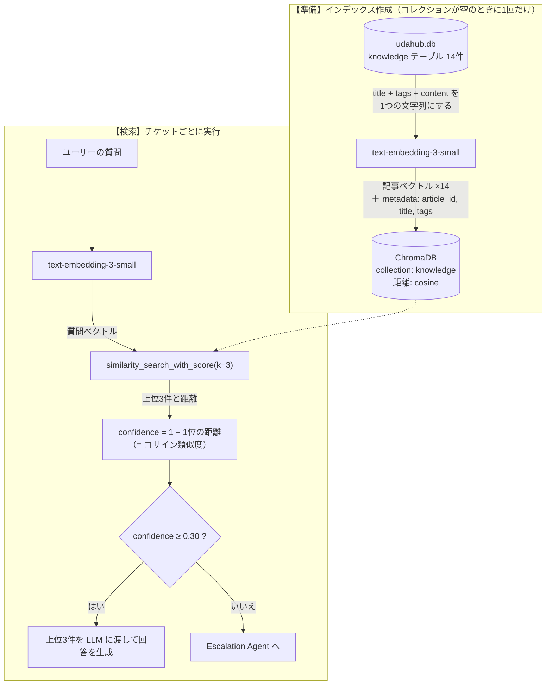
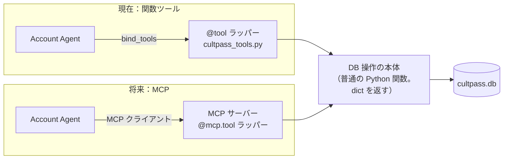

# UDA-Hub アーキテクチャ設計書

## 1. 概要

UDA-Hub は、カスタマーサポートのチケットを自動で処理するマルチエージェントシステムである。
最初の導入顧客は **CultPass**（文化体験のサブスクリプションサービス）。

- チケットを読み取って分類し、担当エージェントへ振り分ける
- ナレッジ記事か CultPass DB の情報をもとに回答する
- 自信を持って答えられないときや、人の判断が必要なときは、人間の担当者にエスカレーションする

| 項目 | 採用するもの |
|---|---|
| オーケストレーション | LangGraph `StateGraph`（グラフはゼロから組み、`create_react_agent` などの既製ワークフローは使わない） |
| LLM | OpenAI `gpt-5.4-mini`（Udacity の Vocareum 経由。`agentic/agents/llm.py` の `get_llm()` を4つのエージェントで共有） |
| 埋め込みモデル | OpenAI `text-embedding-3-small`（ナレッジ検索用） |
| ベクトル DB | ChromaDB（LangChain の `langchain_chroma.Chroma` 経由。ナレッジ記事の埋め込みを保存・検索） |
| アーキテクチャパターン | **スーパーバイザー型**（Classifier が司令塔となり、専門エージェントに振り分ける） |

---

## 2. 全体図



- 四角は **ノード**（LangGraph のグラフ上の処理単位）を表す。
- 矢印のラベルは **条件付きエッジ**（ルーティングの判断）を表す。エスカレーションに進むかどうかは、各ノードが State に `escalation_reason` を入れたかどうかで決める（`workflow.py` の `route_after_*` 関数）。
- 4つのエージェントは `Classifier`、`Knowledge`、`Account`、`Escalation`。`load_memory`、`save_memory`、`account_tools` はエージェントではなく、補助ノードとして扱う。
- エージェントの本体は `agentic/agents/` にある「State を受け取り、更新する項目だけを返す関数」。`workflow.py` はそれをノードとして並べ、条件付きエッジでつなぐ。

---

## 3. エージェントの役割と責任

### 3.1 Classifier Agent（スーパーバイザー）

| 項目 | 内容 |
|---|---|
| 責任 | チケットの内容とメタデータから、行き先と緊急度を決める |
| 入力 | 最新のユーザーメッセージ、直前の会話（ユーザーと AI の本文、最大6件）、チケットのメタデータ（`channel`、`main_issue_type`、`tags`、`created_at`）、過去のやり取りの要約（`past_context`） |
| 出力 | `category`（`knowledge` / `account` / `escalation`）、`urgency`（`low` / `medium` / `high`）、`reason`（判断理由。State には `classification_reason` として入れる） |
| 方法 | LLM の構造化出力（Pydantic モデル `Classification`） |

直前の会話を渡すのは、「Yes, please cancel it」のような短い返事を、その前の質問と同じ行き先に振り分けるためである。

分類の基準は次のとおり。

| category | 該当するチケット | 例 |
|---|---|---|
| `knowledge` | 一般的な質問や手順の質問。ユーザー個別のデータは不要。請求・支払い・返金の質問もここに入れる（アカウントのツールには請求データがないため） | 「QRコードが読み取れない」「サブスクに何が含まれる？」「今月2回請求された」 |
| `account` | そのユーザー自身のデータを見たり、変更したりする必要がある。自分のプランの内容（プラン名、月に使える体験の数）もここに入れる（利用枠はユーザーごとに違い、正しい値はアカウントのデータにしかないため） | 「私の予約を確認したい」「来週の予約をキャンセルして」「私のプランで月に何回使える？」 |
| `escalation` | 人の判断が必要。明確な苦情、法的な話、人間との会話を希望 | 「責任者と話したい」「弁護士に相談する」 |

緊急度の基準は次のとおり。

| urgency | 該当するチケット |
|---|---|
| `high` | ユーザーが怒っている、法的な話をしている、イベントが今日か明日に迫っている |
| `medium` | サービスが使えない、アカウントの操作が必要 |
| `low` | 急ぎではない一般的な質問 |

### 3.2 Knowledge Agent

| 項目 | 内容 |
|---|---|
| 責任 | ナレッジ記事を検索し、**記事の内容だけ**に基づいて回答する |
| 入力 | 最新のユーザーメッセージ、`past_context` |
| 出力 | 回答文（`AIMessage`）、`retrieved_articles`（検索した記事のタイトルとスコア）、`confidence`（信頼度） |
| 方法 | RAG（第5章）。① `search_knowledge` をコードで直接呼ぶ（LLM のツール呼び出しにはしない）。② 信頼度がしきい値未満なら、LLM を呼ばずにエスカレーションする。③ しきい値以上なら、上位3件を LLM に渡し、構造化出力（`KnowledgeAnswer`）で回答させる。記事にない内容は答えないよう指示する |
| エスカレーション条件 | 検索が失敗したとき。`confidence` がしきい値未満のとき。LLM が `needs_escalation = True` を返したとき（記事自体がエスカレーションを指示していて、ユーザーの状況がその条件に当てはまる。または、記事に答えがない） |

- 記事が「まず手順を試し、それでもだめなら人へ」となっている場合（例：QR コードが読めない）は、手順を案内して `resolved` にする。ユーザーは、うまくいかなければ再度問い合わせればよい。
- 記事の条件にすでに当てはまる場合（例：同じ月に2回請求された）は、記事の案内を返したうえでエスカレーションする。

### 3.3 Account Agent

| 項目 | 内容 |
|---|---|
| 責任 | ツールで CultPass DB を照会・操作し、ユーザー個別の依頼を処理する |
| 入力 | 会話全体（`messages`）、チケットのユーザーに対応する CultPass の `user_id` |
| 出力 | ツールの結果をもとにした回答文 |
| 方法 | ① `get_user_profile(user_id)` をコードで直接呼び、ユーザーの有無とブロックを確認する（LLM には任せない）。② LLM にツールを渡し（`bind_tools`）、`account ⇄ account_tools` のループで呼び出す。ループはグラフ上に自分で組む。③ `account_tools` は、LLM が指定した `user_id` を State の値で上書きしてから実行する（他人のデータを操作させないため） |
| エスカレーション条件 | ユーザーが見つからない、アカウントがブロックされている（`is_blocked`）— `account` ノードで判定。ツールがエラーを返した（`ok: False`）— `account_tools` ノードで判定 |

- LLM に渡すツールは `get_subscription`、`get_reservations`、`cancel_reservation` の3つ。`get_user_profile` は①でコードが呼ぶので渡さない。
- キャンセルの対象がはっきりしないときは、キャンセルせずにユーザーに確認するよう指示している。

### 3.4 Escalation Agent

| 項目 | 内容 |
|---|---|
| 責任 | 人間の担当者に引き継ぐ。担当者がすぐ対応できるよう要約を残す |
| 入力 | 会話全体、エスカレーションの理由（`escalation_reason`。Classifier から直接来たときは `classification_reason`）、緊急度、`past_context`、このターンで先に出した案内（あれば） |
| 出力 | ユーザー向けのメッセージ（ユーザーの言語。「担当者が対応します」）、担当者向けの要約（`handoff_summary`、英語） |
| 方法 | LLM の構造化出力（`EscalationOutput`）。最初に `customer_language` を答えさせて、返信の言語を先に決めさせる |
| 副作用 | なし。DB への書き込み（`status` を `escalated` にする、要約を保存する、緊急度をタグに記録する）は `save_memory` が行う（第7章） |

- ユーザー向けのメッセージには、信頼度やツール名、エラー内容、「ブロック」などの内部の情報を書かない。
- Knowledge が先に案内を出してからここに来た場合（例：二重請求）、その案内を引き継ぎのメッセージの前にコードでつなぐ。`chat_interface` は最後のメッセージしか表示しないためである。

---

## 4. 状態（State）と情報の流れ

すべてのノードは、次の共通の状態を読み書きする（`agentic/state.py`）。
LangGraph の `MessagesState` を継承するので、会話の履歴を持つ `messages` フィールド（短期メモリ）はそちらで定義済みになる。新しいメッセージは既存のリストに追記される。

```python
from langgraph.graph import MessagesState

class SupportState(MessagesState):
    # messages: Annotated[list[AnyMessage], add_messages]  ← MessagesState から継承（会話＝短期メモリ）
    ticket_id: str                    # = thread_id
    user_id: str                      # CultPass 側のユーザー ID
    ticket_metadata: dict             # channel, main_issue_type, tags など
    past_context: str                 # 過去のやり取りの要約（長期メモリ）
    category: str                     # Classifier の分類結果（knowledge / account / escalation）
    urgency: str                      # low / medium / high
    classification_reason: str        # Classifier の判断理由
    retrieved_articles: list[dict]    # 検索した記事とスコア
    confidence: float                 # Knowledge の信頼度
    escalation_reason: str | None     # エスカレーションの理由
    handoff_summary: str              # 担当者向けの引き継ぎの要約（Escalation が書く）
    resolution: str                   # resolved / escalated
```

- グラフに渡すのは `messages` と `thread_id`（= `ticket_id`）だけ。`user_id` と `ticket_metadata` は、`load_memory` が `ticket_id` から udahub.db を引いて State に入れる。
- `MemorySaver` は State を丸ごと残すので、`load_memory` はターンの最初に `category` から `resolution` までの「ターンごとの結果」をリセットする。リセットしないと、前のターンの `escalation_reason` が残って間違った行き先に進んでしまう。

具体例として、「来週の予約をキャンセルしたい」というチケットの処理を順に追う。

```
① load_memory      ticket_id から user_id を取得。past_context = "- 2026-11-10 [resolved] ...: "The QR code won't scan..." → ..."
② classifier       category = "account", urgency = "medium"
③ account          get_user_profile(user_id) をコードで確認 → OK。LLM が get_reservations(user_id) を呼ぶ
④ account_tools    → {"ok": true, "data": [{"reservation_id": "r1", ...}]}
⑤ account          LLM が cancel_reservation(user_id, "r1") を呼ぶ
⑥ account_tools    → {"ok": true, "data": {"status": "cancelled", "within_24h": false, ...}}
⑦ account          回答「予約をキャンセルしました。クレジットは戻ります」 resolution = "resolved"
⑧ save_memory      ticket_messages に会話を保存し、status = "resolved"、main_issue_type = "account"、tags = "urgency:medium" にする
```

---

## 5. ナレッジ検索（RAG）と信頼度スコア

### 5.1 仕組み



- **ChromaDB** を LangChain の `Chroma`（`langchain_chroma`）経由で使い、`solution/data/core/chroma/` にコレクション `knowledge` として永続化する（`agentic/tools/knowledge_search.py`）。
  - コレクションは距離の種類を `cosine` にして作る（`collection_metadata={"hnsw:space": "cosine"}`）。
  - 起動時にコレクションが空なら、udahub.db の knowledge テーブルから記事を読み込んで登録する。記事を更新したときは、`get_vector_store(rebuild=True)` でコレクションを作り直す。
  - 各ドキュメントの `id` は `article_id`、`metadata` には `article_id`、`title`、`tags` を入れる。
- ChromaDB が返すのは **距離**（cosine 距離 = 1 − コサイン類似度）なので、**信頼度 = 1 − 1位の距離**（0〜1）として計算する。LLM の自己申告ではなく計算で出すので、同じ入力なら毎回同じ値になり、テストしやすい。
- しきい値は **`0.30`**（`CONFIDENCE_THRESHOLD`）。最初は暫定で `0.45` としていたが、実際のスコア（5.2 節）を見て下げた。
  - `0.45` では「Can I get my money back?」（0.312）が、正しい記事（Refund Policy）を見つけているのにエスカレーションされてしまった。
  - 関係のある質問は 0.312〜0.659、関係のない質問は 0.136〜0.253 だったので、その間の `0.30` にした。
  - 境目は狭い（0.253 と 0.312）。短く曖昧な質問はエスカレーションされることがあるが、間違って答えるより人に回すほうが安全なので許容する。
- しきい値以上でも、LLM が「記事に答えがない」「記事が人の対応を指示している」と判断したときはエスカレーションする（3.2 節）。

### 5.2 実測したスコア（2026-11-14、`text-embedding-3-small`）

| 質問 | 1位の記事 | スコア | 結果 |
|---|---|---|---|
| Do unused experiences carry over to next month? | Unused Monthly Experiences (Rollover) | 0.659 | 回答 |
| The QR code won't scan at the museum entrance | QR Code Not Working at the Venue | 0.643 | 回答 |
| I was charged twice this month | Unexpected or Duplicate Charges | 0.589 | 回答 |
| How do I cancel my booking for tomorrow? | How to Cancel or Change a Reservation | 0.534 | 回答 |
| The app keeps crashing on my phone | App Crashes or Won't Load | 0.530 | 回答 |
| QRコードが読み取れません | QR Code Not Working at the Venue | 0.528 | 回答 |
| How do I change my credit card? | How to Update Payment Method | 0.518 | 回答 |
| I forgot my password and can't log in | How to Handle Login Issues? | 0.459 | 回答 |
| Can I get my money back? | Refund Policy | 0.312 | 回答 |
| Can I bring my dog to the concert? | How to Reserve a Spot for an Event | 0.253 | エスカレーション |
| Do you sell gift cards? | Unused Monthly Experiences (Rollover) | 0.220 | エスカレーション |
| I want to talk to your manager right now | How to Update Profile or Email Address | 0.201 | エスカレーション |
| What's the weather like in Bahia next week? | QR Code Not Working at the Venue | 0.136 | エスカレーション |

関係のある質問では、9件すべてで1位に正しい記事が来た（日本語の質問も含む）。

---

## 6. ツール（CultPass DB の抽象化）

`agentic/tools/cultpass_tools.py` に LangChain の `@tool` 関数として実装する。

| ツール | 入力 | 出力（`data`） | 主なバリデーション |
|---|---|---|---|
| `get_user_profile` | `user_id` | `user_id`、`is_blocked` | ユーザーが存在するか |
| `get_subscription` | `user_id` | `status`、`tier`、`monthly_quota`、開始日・終了日 | ユーザーが存在するか、サブスクがあるか |
| `get_reservations` | `user_id` | 予約一覧（`reservation_id`、体験名、場所、日時、プレミアムかどうか、ステータス）。0件なら空リスト | ユーザーが存在するか |
| `cancel_reservation` | `user_id`、`reservation_id` | 体験名、変更後のステータス、`within_24h` | ユーザーが存在するか、ブロックされていないか、予約が存在するか、そのユーザーのものか、キャンセル済みでないか、イベントが始まっていないか |

- `cancel_reservation` は、ナレッジ記事「How to Cancel or Change a Reservation」のルールに合わせて、開始まで24時間を切っていてもキャンセルできる。そのときは `within_24h = True` を返し、クレジットが消費されることをエージェントがユーザーに伝える。キャンセルすると、体験の空き枠（`slots_available`）を1つ戻す。
- `get_user_profile` は Account Agent がコードで直接呼ぶ（3.3 節）。LLM に渡すのは残りの3つ。

**共通の返り値の形**（構造化された応答）:

```python
{"ok": True,  "data": {...}}                       # 成功
{"ok": False, "error": "Reservation not found"}    # 失敗（例外は投げずに返す）
```

- 同じ形を、ナレッジ検索（`knowledge_search.py`）と長期メモリ（`memory.py`）の関数でも使う。
- cultpass.db への接続は `cultpass_tools.py` の1か所にまとめる。パスは `__file__` を基準にした絶対パスで解決し、ノートブックをどこから実行しても動くようにする。DB ファイルがないときは、空の DB を作らずにエラーを返す。
- エージェントは SQL を直接書かない。ツールを通してだけ DB を触る。

### 6.1 MCP への移行を見据えた構成

指示書では、ツールに MCP サーバーを使うことが推奨されている。まずは理解しやすさを優先して通常の関数ツールで作る。ただし、後から MCP サーバーに置き換えられるよう、ツールを次の2層に分けておく。



- **DB 操作の本体**：引数を受け取って `{"ok", "data"/"error"}` の dict を返す、普通の Python 関数にする。LangChain にも MCP にも依存させない。
- **ラッパー**：本体を呼ぶだけの薄い層にする。今は LangChain の `@tool` で包む（`get_user_profile_tool` など。LLM に見える名前は本体と同じ）。MCP に移るときは、同じ本体を MCP サーバー（例：`FastMCP` の `@mcp.tool`）で包み直せばよい。
- こうしておけば、MCP に移行しても DB 操作のロジックとテストはそのまま使える。
- `knowledge_search.py` にも同じ形のラッパー（`search_knowledge_tool`）を用意している。ただし Knowledge Agent は、確実に検索させるため本体の `search_knowledge` を直接呼ぶ。

---

## 7. メモリ

| 種類 | スコープ | 保存先 | 中身 | 使い方 |
|---|---|---|---|---|
| 短期メモリ | `thread_id`（= `ticket_id`） | LangGraph `MemorySaver` | 同じチケット内の会話、ツール呼び出しとその結果、State | 同じチケットで会話を続けるときの文脈 |
| 長期メモリ | ユーザー（`user_id`） | udahub.db（`ticket_messages`、`ticket_metadata`） | 過去のチケットの会話、解決・エスカレーションの結果、担当者向けの要約 | `load_memory` が同じユーザーの過去チケットを取り出し、`past_context` として Classifier、Knowledge、Escalation に渡す |

長期メモリの読み書きは `agentic/tools/memory.py` の関数で行う。LLM がツールとして呼ぶのではなく、グラフのノード（`load_memory` / `save_memory`）が呼ぶので、`@tool` ラッパーは作らない。

**チケットの作成**

- 新しい問い合わせは `new_ticket(user_id)`（`workflow.py`）で始める。udahub.db にチケットと `ticket_metadata`（`status = open`）を作り、`ticket_id` を返す。この `ticket_id` を `thread_id` としてグラフを呼ぶ。
- udahub.db にまだいないユーザーなら、ユーザーも作る（名前などの個人情報は増やさない）。

**読み込み（`load_memory`）**

- `thread_id` からチケットを引き、CultPass の `user_id` と `ticket_metadata` を State に入れる。
- 同じユーザーの過去のチケット（今のチケットを除く）を新しい順に最大3件取り出し、日付、結果、分類、最初のユーザーの発言と最後の AI の発言（各150文字まで）を短い文章にまとめて `past_context` にする。初めてのユーザーは「No past tickets from this customer.」になる。
- DB の関数がエラーを返してもグラフは止めない（`user_id` が空なら、Account Agent がエスカレーションする）。

**保存（`save_memory`）** — udahub.db に書くのはこのノードだけ（エージェントは書かない）。

- 会話のうち、ユーザーの発言と本文のある AI の発言を `ticket_messages` に保存する。ツールの呼び出しや結果は短期メモリで確認できるので入れない。`message.id` で重複を飛ばすので、同じチケットで会話が続いても二重に保存しない。
- エスカレーションしたときは、`handoff_summary` を `role = system`（`[Handoff] ...`）で `ticket_messages` に保存する。`past_context` には user と ai の発言しか使わないので、要約は混ざらない。
- `ticket_metadata` の `status` をそのターンの結果（`resolved` / `escalated`、結果がなければ `open`）で上書きする。ただし一度 `escalated` になったチケットは `escalated` のままにする（担当者の対応待ちが、次のターンの `resolved` で見えなくならないように）。
- `main_issue_type` に Classifier の `category` を、`tags` に `urgency:<緊急度>` を記録する。

**例**：前回「QRコードが読めない」で解決したユーザーが再び来たら、`past_context` にそのチケットが入るので、「前回も QR コードの件でお問い合わせいただきました」と文脈を踏まえて応答できる。

`thread_id` を指定すれば、`graph.get_state(config)` や `graph.get_state_history(config)` でそのチケットのメッセージやツール使用状況を確認できる。

---

## 8. 入力の種類と期待される出力

| 入力の種類 | 経路 | 期待される出力 | 03 ノートブック |
|---|---|---|---|
| 一般的な質問（記事あり） | Classifier → Knowledge | 記事に基づく回答。`resolved` | シナリオ 1 |
| 一般的な質問（記事なし） | Classifier → Knowledge → Escalation | 引き継ぎのメッセージ。`escalated` | シナリオ 5（ギフトカード） |
| 記事がエスカレーションを指示している（二重請求など） | Classifier → Knowledge → Escalation | 記事の案内と引き継ぎ。`escalated` | シナリオ 3 |
| ユーザー個別の照会・操作 | Classifier → Account ⇄ Tools | ツールの結果に基づく回答。`resolved` | シナリオ 2 |
| ユーザー不明・ブロック済み | Classifier → Account → Escalation | 引き継ぎのメッセージ。`escalated` | シナリオ 4 |
| ツールのエラー | Classifier → Account ⇄ Tools → Escalation | 引き継ぎのメッセージ。`escalated` | — |
| 明確に人を求める・苦情 | Classifier → Escalation | 引き継ぎのメッセージ。緊急度を記録して `escalated` | シナリオ 5（責任者と話したい） |

---

## 9. ログ

- Python の `logging` を使い、1行に1件の JSON を書く（JSON Lines）。出力先は `solution/logs/workflow.jsonl`（`agentic/logging_utils.py` の `log_event`）。
- ログは `workflow.py` だけで書く。エージェントのコードには入れず、「エージェントを呼んでログを1行書く」小さな関数（`classifier_step` など）でノードを包む。
- 記録するイベントは次のとおり。

| node | event | 主な項目 |
|---|---|---|
| `load_memory` | `memory_loaded` | `user_id`、`past_tickets`（過去チケットの件数）、`error` |
| `classifier` | `classified` | `category`、`urgency`、`reason` |
| `knowledge` | `retrieved` | `top_article`、`confidence`、`escalation_reason` |
| `account` | `account_step` | `tool_calls`（LLM が呼んだツール名）、`escalation_reason` |
| `account_tools` | `tool_called` | `tool`、`ok`、`error`（ツールごとに1行） |
| `escalation` | `escalated` | `reason`、`urgency` |
| `save_memory` | `saved` | `status`、`resolution`、`errors`（DB の関数のエラー） |

```json
{"ts": "2026-11-14T10:00:00", "ticket_id": "t-001", "node": "classifier", "event": "classified", "category": "knowledge", "urgency": "low", "reason": "..."}
{"ts": "2026-11-14T10:00:01", "ticket_id": "t-001", "node": "knowledge", "event": "retrieved", "top_article": "QR Code Not Working at the Venue", "confidence": 0.643, "escalation_reason": null}
```

`ticket_id` や `event` で検索、絞り込みができる。ノートブックでは `read_logs(ticket_id)` で1つのチケットの流れを確認できる。

---

## 10. テスト方針

| テスト | 確かめること | 場所 |
|---|---|---|
| ツールの単体テスト | 正常系、存在しないユーザー、ブロック済みのユーザー、他人の予約のキャンセル、キャンセル済みの予約、開始済みのイベント、24時間以内のキャンセル、引数の不足、DB ファイルがない、`@tool` ラッパーが本体と同じ結果を返す | `tests/test_cultpass_tools.py` |
| ナレッジ検索 | 関係のある質問のスコアがしきい値以上で、関係のない質問はしきい値未満になる。スコアの高い順に並ぶ。空の質問や検索の失敗はエラーを返す | `tests/test_knowledge_search.py` |
| 長期メモリ | チケットの作成、メッセージの保存（二重に保存しない）、status の更新、過去のチケットの取り出し（新しい順・件数の上限・ユーザーを混ぜない）、引き継ぎの要約が `past_context` に混ざらない | `tests/test_memory.py` |
| ルーティング・エンドツーエンド | サンプルチケットごとに期待するエージェントへ振り分けられ、「解決」と「エスカレーション」の両方のシナリオが動く（第8章の表） | `03_agentic_app.ipynb` のシナリオ 1〜5 |
| 短期メモリ | 同じ `thread_id` で会話が続く（シナリオ 2 の2回目の質問）。`get_state_history` でツールの呼び出しも確認できる | `03_agentic_app.ipynb` |

- `tests/` は pytest で実行する（`solution/` から `pytest`）。ナレッジ検索の一部のテストは、埋め込みの API を呼ぶ。
- ルーティングとエンドツーエンドは LLM の出力によって変わるので、自動テストにはせず、ノートブックで結果（`category`、`resolution`、ログ）を確認する。

---

## 11. ファイル構成

```text
solution/agentic/
├── design/architecture.md     # この設計書
├── state.py                   # 共有する State（SupportState）
├── agents/
│   ├── llm.py                 # 4つのエージェントが共有する LLM（get_llm）
│   ├── classifier.py
│   ├── knowledge.py
│   ├── account.py             # account ノードと account_tools ノード
│   └── escalation.py
├── tools/
│   ├── cultpass_tools.py      # CultPass DB ツール（本体 + @tool ラッパー）
│   ├── knowledge_search.py    # RAG 検索（ChromaDB）
│   └── memory.py              # 長期メモリの読み書き（udahub.db）
├── logging_utils.py           # 構造化ログ
└── workflow.py                # StateGraph の組み立て、orchestrator、new_ticket

solution/tests/                # pytest（ツール、ナレッジ検索、長期メモリ）

solution/data/
├── external/cultpass.db       # CultPass の DB（01 ノートブックで作成）
└── core/
    ├── udahub.db              # UDA-Hub の DB（02 ノートブックで作成）
    └── chroma/                # ChromaDB の永続化ディレクトリ（自動生成）

solution/logs/workflow.jsonl   # ログ（自動生成）
```

`State` を `workflow.py` ではなく `state.py` に置くのは、エージェントと `workflow.py` の両方が import するためである（`workflow.py` に置くと循環 import になる）。

MCP に移行する場合は、`tools/mcp_server.py` を追加して、`cultpass_tools.py` の本体関数を MCP ツールとして公開する。
