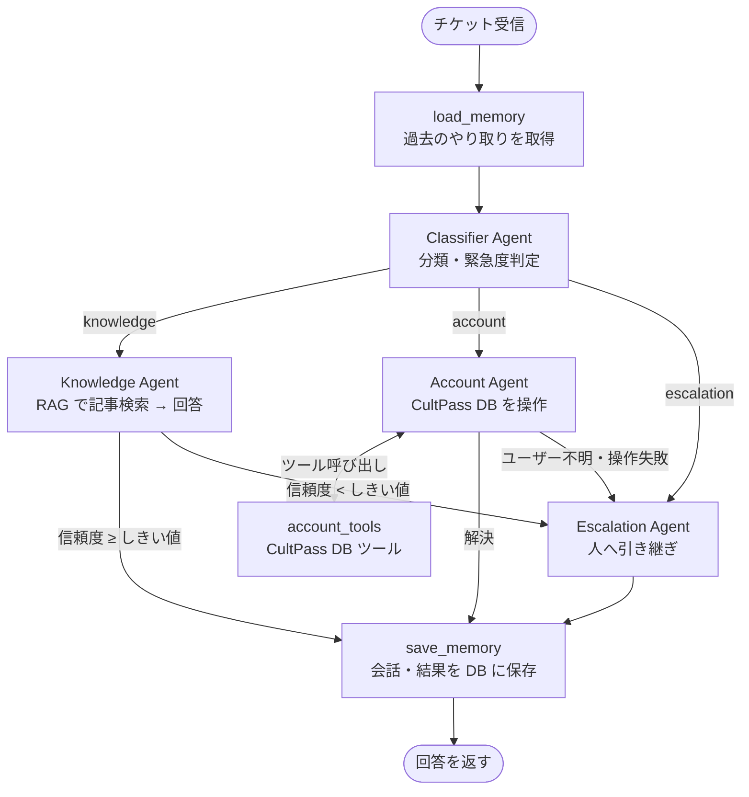
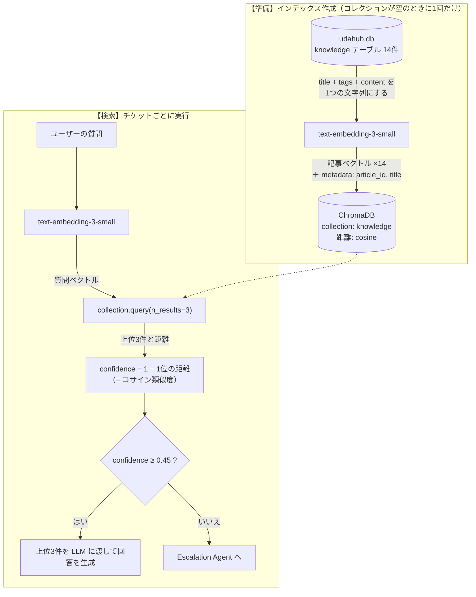
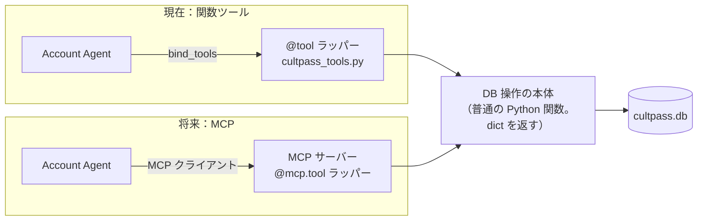

# UDA-Hub アーキテクチャ設計書

## 1. 概要

UDA-Hub は、カスタマーサポートのチケットを自動で処理するマルチエージェントシステムである。
最初の導入顧客は **CultPass**（文化体験のサブスクリプションサービス）。

- チケットを読み取って分類し、担当エージェントへ振り分ける
- ナレッジ記事か CultPass DB の情報をもとに回答する
- 自信を持って答えられないときや、人の判断が必要なときは、人間の担当者にエスカレーションする

| 項目 | 採用するもの |
|---|---|
| オーケストレーション | LangGraph `StateGraph`（グラフはゼロから組み、`create_react_agent` などの既製ワークフローは使わない） |
| LLM | OpenAI `gpt-5.4-mini` |
| 埋め込みモデル | OpenAI `text-embedding-3-small`（ナレッジ検索用） |
| ベクトル DB | ChromaDB（ナレッジ記事の埋め込みを保存・検索） |
| アーキテクチャパターン | **スーパーバイザー型**（Classifier が司令塔となり、専門エージェントに振り分ける） |

---

## 2. 全体図



- 四角は **ノード**（LangGraph のグラフ上の処理単位）を表す。
- 矢印のラベルは **条件付きエッジ**（ルーティングの判断）を表す。
- 4つのエージェントは `Classifier`、`Knowledge`、`Account`、`Escalation`。`load_memory`、`save_memory`、`account_tools` はエージェントではなく、補助ノードとして扱う。

---

## 3. エージェントの役割と責任

### 3.1 Classifier Agent（スーパーバイザー）

| 項目 | 内容 |
|---|---|
| 責任 | チケットの内容とメタデータから、行き先と緊急度を決める |
| 入力 | 最新のユーザーメッセージ、チケットのメタデータ（`channel`、`main_issue_type`、`tags`、`created_at`）、過去のやり取りの要約 |
| 出力 | `category`（`knowledge` / `account` / `escalation`）、`urgency`（`low` / `medium` / `high`）、`reason`（判断理由） |
| 方法 | LLM の構造化出力（Pydantic モデル） |

分類の基準は次のとおり。

| category | 該当するチケット | 例 |
|---|---|---|
| `knowledge` | 一般的な質問や手順の質問。ユーザー個別のデータは不要 | 「QRコードが読み取れない」「サブスクに何が含まれる？」 |
| `account` | そのユーザー自身のデータを見たり、変更したりする必要がある | 「私の予約を確認したい」「来週の予約をキャンセルして」 |
| `escalation` | 人の判断が必要。明確な苦情、法的な話、人間との会話を希望 | 「責任者と話したい」「弁護士に相談する」 |

### 3.2 Knowledge Agent

| 項目 | 内容 |
|---|---|
| 責任 | ナレッジ記事を検索し、**記事の内容だけ**に基づいて回答する |
| 入力 | ユーザーメッセージ |
| 出力 | 回答文、参照した記事のタイトル、`confidence`（信頼度） |
| 方法 | RAG（第5章）。上位の記事を LLM に渡し、記事にない内容は答えないよう指示する |
| エスカレーション条件 | `confidence` がしきい値未満のとき。または、記事自体がエスカレーションを指示しているとき（例：二重請求、例外的な返金） |

### 3.3 Account Agent

| 項目 | 内容 |
|---|---|
| 責任 | ツールで CultPass DB を照会・操作し、ユーザー個別の依頼を処理する |
| 入力 | ユーザーメッセージ、チケットのユーザーに対応する CultPass の `user_id` |
| 出力 | ツールの結果をもとにした回答文 |
| 方法 | LLM にツールを渡し（`bind_tools`）、`account_agent ⇄ account_tools` のループで呼び出す。ループはグラフ上に自分で組む |
| エスカレーション条件 | ユーザーが見つからない、アカウントがブロックされている（`is_blocked`）、ツールがエラーを返した |

### 3.4 Escalation Agent

| 項目 | 内容 |
|---|---|
| 責任 | 人間の担当者に引き継ぐ。担当者がすぐ対応できるよう要約を残す |
| 入力 | 会話全体、エスカレーションの理由、緊急度 |
| 出力 | ユーザー向けのメッセージ（「担当者に引き継ぎました」）、担当者向けの要約 |
| 副作用 | udahub.db の `ticket_metadata.status` を `escalated` にし、緊急度をタグに記録する |

---

## 4. 状態（State）と情報の流れ

すべてのノードは、次の共通の状態を読み書きする。
LangGraph の `MessagesState` を継承するので、会話の履歴を持つ `messages` フィールド（短期メモリ）はそちらで定義済みになる。新しいメッセージは既存のリストに追記される。

```python
from langgraph.graph import MessagesState

class SupportState(MessagesState):
    # messages: list[AnyMessage]  ← MessagesState から継承（会話＝短期メモリ）
    ticket_id: str                           # = thread_id
    user_id: str                             # CultPass 側のユーザー ID
    ticket_metadata: dict                    # channel, main_issue_type, tags など
    past_context: str                        # 過去のやり取りの要約（長期メモリ）
    category: str                            # Classifier の分類結果
    urgency: str                             # low / medium / high
    retrieved_articles: list[dict]           # 検索した記事とスコア
    confidence: float                        # Knowledge の信頼度
    escalation_reason: str | None            # エスカレーションの理由
    resolution: str                          # resolved / escalated
```

具体例として、「来週の予約をキャンセルしたい」というチケットの処理を順に追う。

```
① load_memory      past_context = "前回: QRコードの件で解決済み"
② classifier       category = "account", urgency = "medium"
③ account_agent    → get_reservations(user_id) を呼ぶ
④ account_tools    → {"ok": true, "data": [{"reservation_id": "r1", ...}]}
⑤ account_agent    → cancel_reservation(user_id, "r1") を呼ぶ
⑥ account_tools    → {"ok": true, "data": {"status": "cancelled"}}
⑦ account_agent    回答「予約 r1 をキャンセルしました」 resolution = "resolved"
⑧ save_memory      ticket_messages に会話を保存し、status = "resolved" にする
```

---

## 5. ナレッジ検索（RAG）と信頼度スコア

### 5.1 仕組み



- **ChromaDB** を使い、`solution/data/core/chroma/` にコレクション `knowledge` として永続化する。
  - コレクションは距離の種類を `cosine` にして作る（`metadata={"hnsw:space": "cosine"}`）。
  - 起動時にコレクションが空なら、udahub.db の knowledge テーブルから記事を読み込んで登録する。記事を更新したときは、コレクションを作り直す。
  - 各ドキュメントの `id` は `article_id`、`metadata` には `title` と `tags` を入れる。
- ChromaDB が返すのは **距離**（cosine 距離 = 1 − コサイン類似度）なので、**信頼度 = 1 − 1位の距離**（0〜1）として計算する。LLM の自己申告ではなく計算で出すので、同じ入力なら毎回同じ値になり、テストしやすい。
- しきい値は暫定で `0.45` とする。テストケース（関係のある質問とない質問）で実際のスコアを見てから調整する。

### 5.2 具体例（スコアは説明用の想定値）

| 質問 | 1位の記事 | スコア | 結果 |
|---|---|---|---|
| 「QRコードが会場で読めない」 | QR Code Not Working at the Venue | 0.72 | 回答 |
| 「パスワードを忘れた」 | How to Handle Login Issues? | 0.65 | 回答 |
| 「ペットを連れて行ける？」 | What's Included in a CultPass Subscription | 0.28 | エスカレーション |

---

## 6. ツール（CultPass DB の抽象化）

`agentic/tools/cultpass_tools.py` に LangChain の `@tool` 関数として実装する。

| ツール | 入力 | 出力（`data`） | 主なバリデーション |
|---|---|---|---|
| `get_user_profile` | `user_id` | ユーザーの有無、`is_blocked` | ユーザーが存在するか |
| `get_subscription` | `user_id` | `status`、`tier`、`monthly_quota` | サブスクがあるか |
| `get_reservations` | `user_id` | 予約一覧（体験名、日時、ステータス） | — |
| `cancel_reservation` | `user_id`、`reservation_id` | 変更後のステータス | 予約がそのユーザーのものか、キャンセル済みでないか |

**共通の返り値の形**（構造化された応答）:

```python
{"ok": True,  "data": {...}}                       # 成功
{"ok": False, "error": "Reservation not found"}    # 失敗（例外は投げずに返す）
```

- DB への接続は `tools` 内の1か所にまとめる。パスは `__file__` を基準にした絶対パスで解決し、ノートブックをどこから実行しても動くようにする。
- エージェントは SQL を直接書かない。ツールを通してだけ DB を触る。
### 6.1 MCP への移行を見据えた構成

指示書では、ツールに MCP サーバーを使うことが推奨されている。まずは理解しやすさを優先して通常の関数ツールで作る。ただし、後から MCP サーバーに置き換えられるよう、ツールを次の2層に分けておく。



- **DB 操作の本体**：引数を受け取って `{"ok", "data"/"error"}` の dict を返す、普通の Python 関数にする。LangChain にも MCP にも依存させない。
- **ラッパー**：本体を呼ぶだけの薄い層にする。今は LangChain の `@tool` で包む。MCP に移るときは、同じ本体を MCP サーバー（例：`FastMCP` の `@mcp.tool`）で包み直せばよい。
- こうしておけば、MCP に移行しても DB 操作のロジックとテストはそのまま使える。

---

## 7. メモリ

| 種類 | スコープ | 保存先 | 中身 | 使い方 |
|---|---|---|---|---|
| 短期メモリ | `thread_id`（= `ticket_id`） | LangGraph `MemorySaver` | 同じチケット内の会話、ツール呼び出し | 同じセッションで会話を続けるときの文脈 |
| 長期メモリ | ユーザー（`user_id`） | udahub.db（`ticket_messages`、`ticket_metadata`） | 過去のチケットの会話、解決・エスカレーションの結果 | `load_memory` が同じユーザーの過去チケットを取り出し、`past_context` として Classifier と各エージェントに渡す |

- `save_memory` は、会話の各メッセージを `ticket_messages` に、結果（`resolved` / `escalated`）を `ticket_metadata.status` に保存する。
- 例：前回「QRコードが読めない」で解決したユーザーが再び来たら、「前回も QR コードの件でお問い合わせいただきました」と文脈を踏まえて応答できる。
- `thread_id` を指定すれば、`graph.get_state(config)` でそのセッションのメッセージやツール使用状況を確認できる。

---

## 8. 入力の種類と期待される出力

| 入力の種類 | 経路 | 期待される出力 |
|---|---|---|
| 一般的な質問（記事あり） | Classifier → Knowledge | 記事に基づく回答と参照記事名。`resolved` |
| 一般的な質問（記事なし） | Classifier → Knowledge → Escalation | 引き継ぎのメッセージ。`escalated` |
| 記事がエスカレーションを指示している（二重請求など） | Classifier → Knowledge → Escalation | 記事の案内と引き継ぎ。`escalated` |
| ユーザー個別の照会・操作 | Classifier → Account ⇄ Tools | ツールの結果に基づく回答。`resolved` |
| ユーザー不明・ツールのエラー | Classifier → Account → Escalation | 引き継ぎのメッセージ。`escalated` |
| 明確に人を求める・苦情 | Classifier → Escalation | 引き継ぎのメッセージ。緊急度を記録して `escalated` |

---

## 9. ログ

- Python の `logging` を使い、1行に1件の JSON を書く（JSON Lines）。出力先は `solution/logs/workflow.jsonl`。
- 記録するイベントは、分類結果、ルーティング先、検索スコア、ツール呼び出しとその結果、エスカレーションの理由、最終結果。

```json
{"ts": "2026-11-14T10:00:00", "ticket_id": "t-001", "node": "classifier", "event": "routed", "category": "knowledge", "urgency": "low"}
{"ts": "2026-11-14T10:00:01", "ticket_id": "t-001", "node": "knowledge", "event": "retrieved", "top_article": "QR Code Not Working at the Venue", "confidence": 0.72}
```

`ticket_id` や `event` で検索、絞り込みができる。

---

## 10. テスト方針

| テスト | 確かめること |
|---|---|
| ツールの単体テスト | 正常系、存在しないユーザー、他人の予約のキャンセル、キャンセル済みの予約 |
| ナレッジ検索 | 関係のある質問のスコアがしきい値以上で、関係のない質問はしきい値未満になる |
| ルーティング | サンプルチケットごとに、期待するエージェントへ振り分けられる |
| エンドツーエンド | 「解決」と「エスカレーション」の両方のシナリオ |
| メモリ | 同じ `thread_id` で会話が続く。2回目のチケットで過去のやり取りを参照できる |

---

## 11. ファイル構成（予定）

```text
solution/agentic/
├── design/architecture.md     # この設計書
├── agents/
│   ├── classifier.py
│   ├── knowledge.py
│   ├── account.py
│   └── escalation.py
├── tools/
│   ├── cultpass_tools.py      # CultPass DB ツール（本体 + @tool ラッパー）
│   ├── knowledge_search.py    # RAG 検索（ChromaDB）
│   └── memory.py              # 長期メモリの読み書き（udahub.db）
├── logging_utils.py           # 構造化ログ
└── workflow.py                # StateGraph の組み立て

solution/data/core/
├── udahub.db
└── chroma/                    # ChromaDB の永続化ディレクトリ（自動生成）
```

MCP に移行する場合は、`tools/mcp_server.py` を追加して、`cultpass_tools.py` の本体関数を MCP ツールとして公開する。
